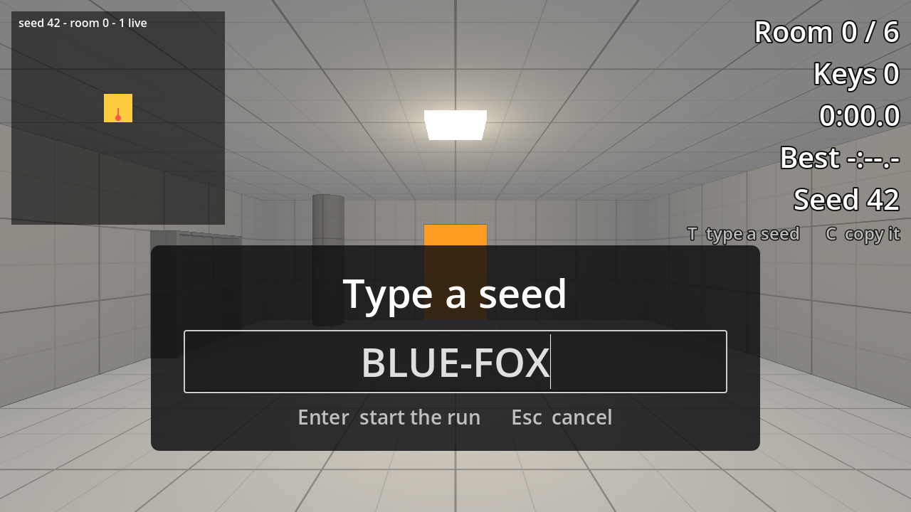

# Seeds You Can Share in Godot 4

Project files for tutorial 06 of the Godot 4 series by Phaix on YouTube (https://www.youtube.com/@Phaix).

Make the seed of a generated Godot 4 level something you can send to a friend: a seed as text with a hash you own instead of the engine's, a box to type it and a key to copy it, a child seed for every room and every kind of dice so that a new feature moves nothing else, a mixer instead of a sum to avoid the deep echo, a headless check that measures it, and a lamp colour on a stream of its own. Every step is its own project folder.



## Steps

Every step of the video is its own folder in `steps/`, the exact state at the end of that
part. Open the project in Godot 4.7, then open `steps/<step>/main.tscn` and press F6 to run
that step. The project's main scene is the final step.

| Folder | Part of the video |
|---|---|
| `steps/step_00_start` | Starting point (the final state of the previous tutorial) |
| `steps/step_01_seed_text` | Step 1 - A seed is a text |
| `steps/step_02_type_and_copy` | Step 2 - Type it, copy it |
| `steps/step_03_room_seeds` | Step 3 - One seed for every room |
| `steps/step_04_hashed_seeds` | Step 4 - Mix the seeds, do not add them |
| `steps/step_05_lamp_streams` | Step 5 - A new feature, a new stream |

## Controls

WASD or arrow keys or the left stick to walk, mouse or right stick to look, Space to jump,
Esc gives the mouse back, a click captures it again. Further keys per tutorial are shown
in the video and in the HUD.

## Tests

```sh
godot --headless --path . -s res://tests/run_tests.gd
```

## License

Code and scenes: MIT (see LICENSE).
